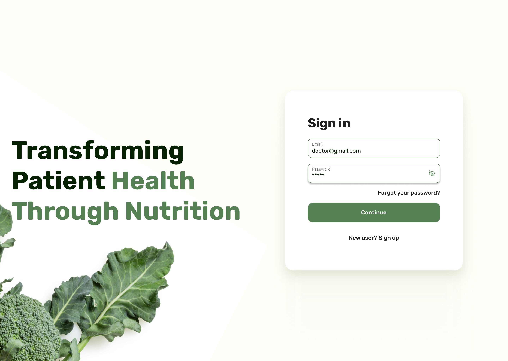
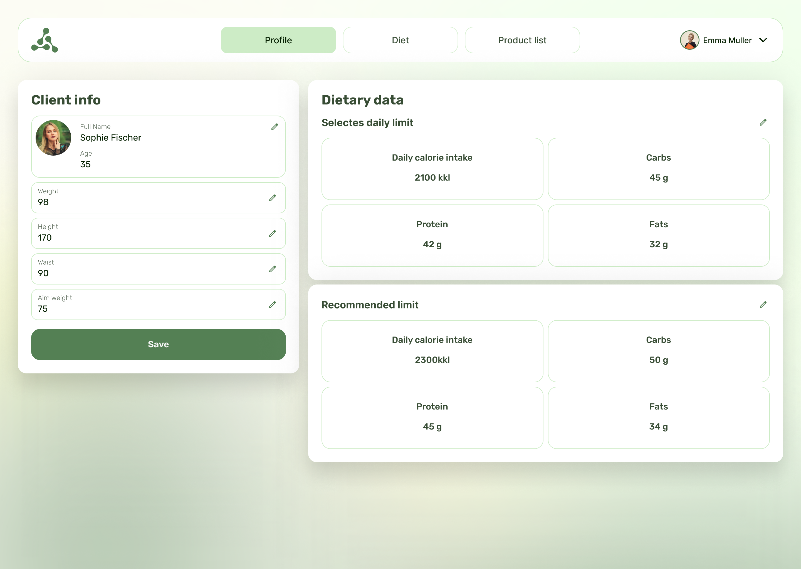
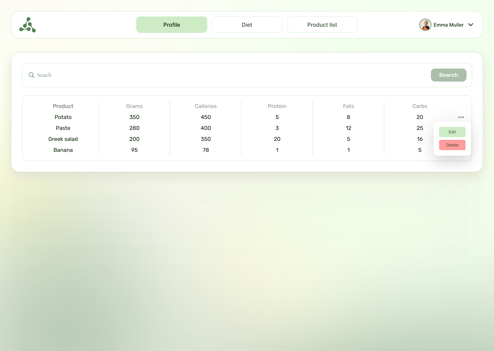
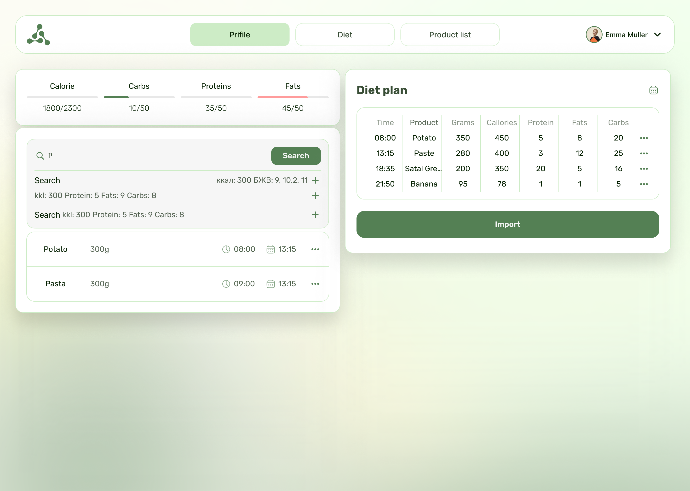

# Diet Dash

A web app for nutritionists: keep patient profiles, build daily meal plans from a product database, and export ready-to-print diets.

Diet Dash started as a startup in 2024 (Spring Boot backend + React frontend). The startup is closed; this repository is the final, self-hosted version of the product: one repo, one `docker compose`, deployable to any VPS.

<p align="center">
  
  
  
  
</p>

## What it does

- **Patient profiles**: age, height, weight, body measurements, activity level, goal weight. BMI, daily calorie norm and protein/fat/carb limits are calculated from them.
- **Meal plans**: add products and meals per day, see totals against the patient's limits, copy a day's plan to other dates.
- **Product database**: ~9,900 products (English + Ukrainian names) with calories and macros per 100 g, seeded from a CSV; searchable, with custom products.
- **Export**: a plan downloads as `.docx` or `.xlsx` to hand to the patient.
- **Accounts**: registration with email confirmation, password reset, JWT auth, rate-limited auth endpoints.
- **Languages**: English, Ukrainian, Russian.

## Stack

| Part | Tech |
|---|---|
| Backend | Node.js, [Hono](https://hono.dev), TypeScript, `postgres.js`, `zod`, `bcryptjs`, JWT |
| Frontend | React, Redux Toolkit, MUI + Bootstrap, i18next |
| Database | PostgreSQL |
| Email | Mailtrap API |
| Deploy | Docker, nginx, Coolify |

```
browser ──► frontend (nginx, static React build)
               │  REST /api/*
               ▼
            backend (Hono on Node, :5000) ──► PostgreSQL
                                          └──► Mailtrap (confirmation / reset emails)
```

## Run locally

```bash
cp backend/.env.example backend/.env.local   # DATABASE_URL host = postgres; set JWT_SECRET, MAILTRAP_API_TOKEN
docker compose -f docker-compose.local.yml up --build
```

On first start the backend creates the tables and seeds the product database. Set `TEST_USER_PASSWORD` to also create a demo account `test@dietdash.com`.

Deploying to Coolify step by step: [DEPLOY.md](DEPLOY.md) (in Russian).

## Project layout

```
backend/
  src/routes/      auth, users, profiles, products, rations (meal plans)
  src/services/    email, export (.docx / .xlsx)
  src/seed.ts      schema + product seed
  data/            product database CSV
frontend/
  src/components/  landing, login, home page (profiles, diet, products)
  src/locales/     en / uk / ru
docker-compose.local.yml     local run
docker-compose.coolify.yml   production
```
